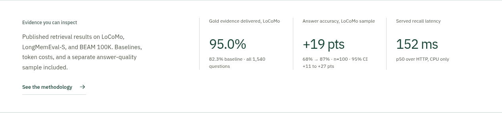

# Formatting review

Reviewed the current website on 2026-10-31 using Chromium screenshots, rendered text measurements, and the browser/accessibility suite. The existing design and benchmark values are preserved.

## 1. Evidence columns — fixed

The answer-accuracy caption inherited `white-space: nowrap` from its value. At a 1280-pixel viewport it extended about 59 pixels beyond its column and touched the latency caption. Page-wide overflow checks missed it because the text stayed inside the overall page.

Before:

After:

Captions now wrap within their own cells, grid children may shrink correctly, and label height keeps the three numeric values aligned. Client links use a consistent font size, including “Any MCP client.”

## 2. Pages and responsive layout — passed

All 21 content routes were checked at 320, 360, 390, 430, 600, 768, 900, 901, 1024, 1130, 1280, 1440, 1536, and 1920 pixels: 294 initial page/width combinations. Desktop and mobile page screenshots were captured, with desktop page overviews reviewed for heading placement, section spacing, cards, navigation, and footers.

The final automated checks found no horizontal page overflow, text extending beyond its layout column, text cut by a clipping boundary, failed page responses, or broken image elements in the checked states. Code blocks and wide data tables retain intentional local scrolling. Font line-box overhang is distinguished from actual clipping, rather than changing typography to hide a measurement artifact.

## 3. Interactive controls and accessibility — passed

Another 69 states were checked at 320, 768, and 1280 pixels: five memory-loop stages, six memory types, three benchmark datasets, operating-system/client controls, empty search results, and contact validation errors. No containment failures were detected.

All 43 browser tests pass, including WCAG-tagged Axe checks on every content route and a new geometry regression test at nine widths. That test measures caption text against its own column and checks numeric alignment and client-label font consistency. Lint, TypeScript, the build, and six contact tests also pass.

## Reproduce and evidence limits

Run `npm run build`, then `npm run audit:layout` after installing Python Playwright as described in the README. The workflow discovers routes from the sitemap, manages its server through the installed testing skill, writes screenshots and a JSON report to `artifacts/layout-audit`, and fails if layout findings remain. A custom route JSON file and viewport list can be supplied to the Python script.

The compact result is [layout-audit-summary.json](evidence/layout-audit-summary.json). Generated full-page captures and the detailed report are included in the separate formatting-audit archive supplied with this release.

This verifies the listed Chromium sizes and states. Screenshots alone do not establish full accessibility compliance, and the review does not claim coverage of every browser, device, font-scaling setting, or assistive technology.
