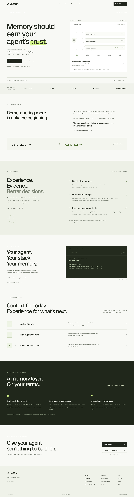
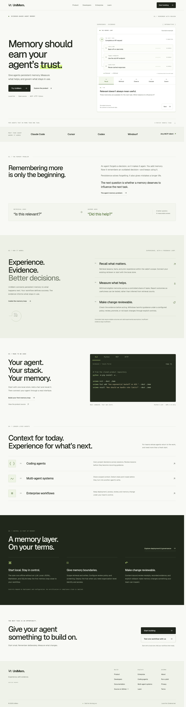
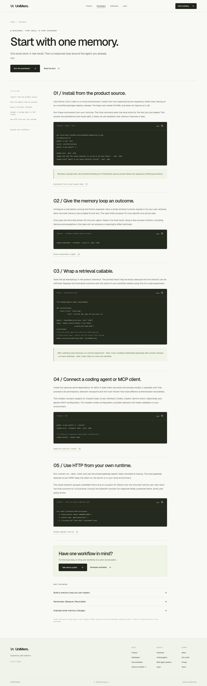
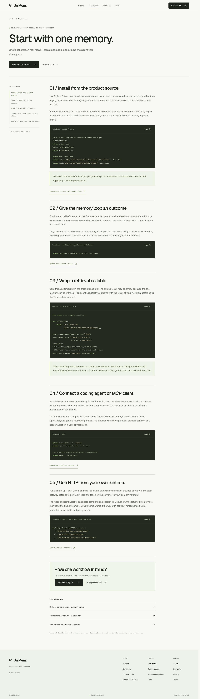
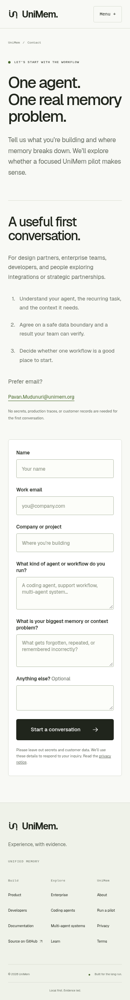
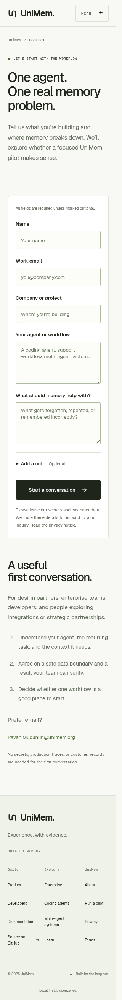

# Refinement review

Refined the existing UniMem website around clarity, readable evidence, and deliberate interaction. The original source-backed positioning and product qualifications remain the basis for the site. No attempt was made to copy another company's website or to claim endorsement by a named designer or founder.

## 1. Understand the product — healthy after refinement

Captured the homepage in this review at 1440 px and on narrow screens. The existing brand, section sequence, and restrained palette were sound. The 320 px headline wrapped to five lines, diagram text was miniature, and the small arrow did little to explain how to advance the demonstration.

Changes:

- Three deliberate headline lines down to 320 px; shorter explanatory copy.
- Centered desktop navigation, a persistent header, clearer active state, and consistent button geometry.
- Rebuilt the signature visual with a task, connected memory rows, readable status text, numbered stages, an explicit Next control, and a restart action.
- Simulated outcomes remain clearly identified. No customer data or benchmark claim was added.
- Stable visual height across all five stages at 320, 375, 768, 1024, and 1440 px was separately measured.
- Larger secondary type, code, supporting captions, and footer links; dark-section keyboard focus stays visible.

Before:

After:

## 2. Explore the implementation — healthy after refinement

Captured the developer page and an educational article. Working examples and source links were useful, but code was very small on phones, the mobile outline crowded the introduction, and every article began with a developer conversion action before the reading experience.

Changes:

- Code uses readable 12 px type, gentle token highlighting, and visual wrapping; copied text preserves the exact original command.
- Clipboard failures select the source text. Copy feedback resets when examples change; timers clean up on unmount.
- Editorial pages have a word-count-derived reading-time estimate and a quieter introduction.
- Desktop outlines indicate the current section. Mobile outlines use native, keyboard-operable disclosure.
- Breadcrumbs name the actual page. Documentation actions have distinct destinations.
- Existing content routes, source qualifications, canonical URLs, and metadata remain intact.

Before:

After:

## 3. Start a pilot conversation — healthy interface; delivery still needs configuration

Captured contact at 320 px. The form originally appeared after a long explanation, required labels were unclear, fields used a size that can trigger iOS zoom, and delivery failures referred visitors to a separate email link rather than offering recovery where the error appeared.

Changes:

- On small screens the form comes before the explanation. Desktop retains its two-column composition.
- Shorter labels, a clear required-field note, 16 px input text, generous touch targets, and visible focus.
- Optional notes use a disclosure; entered data remains in the request.
- Field errors appear on blur and clear when corrected. Errors keep entered values and provide a direct email recovery link.
- Retry keys include a digest of submitted fields: identical retries deduplicate, corrected submissions are distinct.
- Mobile navigation closes with Escape, restores toggle focus, closes outside, and clears when the layout becomes desktop.

Before:

After:

## Evidence and limits

Screenshots are fresh captures from this refinement run, saved locally and visually inspected. Final build, browser, accessibility, and performance results are recorded in [QA](qa.md). Automated checks cover all 16 routes, the five demo states, narrow layouts, menu dismissal, outlines, clipboard fallback, and form interaction.

Screenshot inspection alone does not establish accessibility conformance. Chromium testing does not establish Safari, Firefox, physical-device, or screen-reader behavior. Vercel hosting, production field performance, real inbox delivery, and legal review remain unverified. GitHub repository creation and deployment setup remain the previously documented external handoff requirements.
